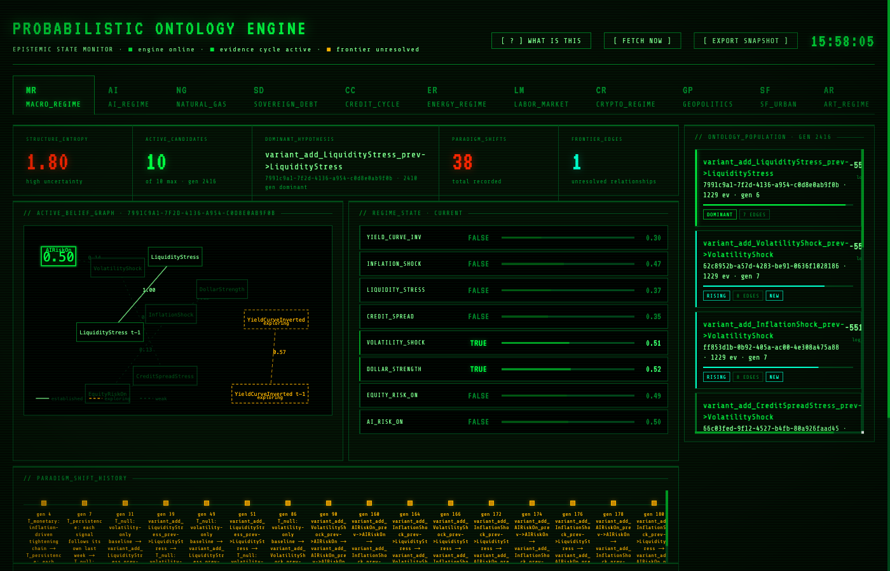
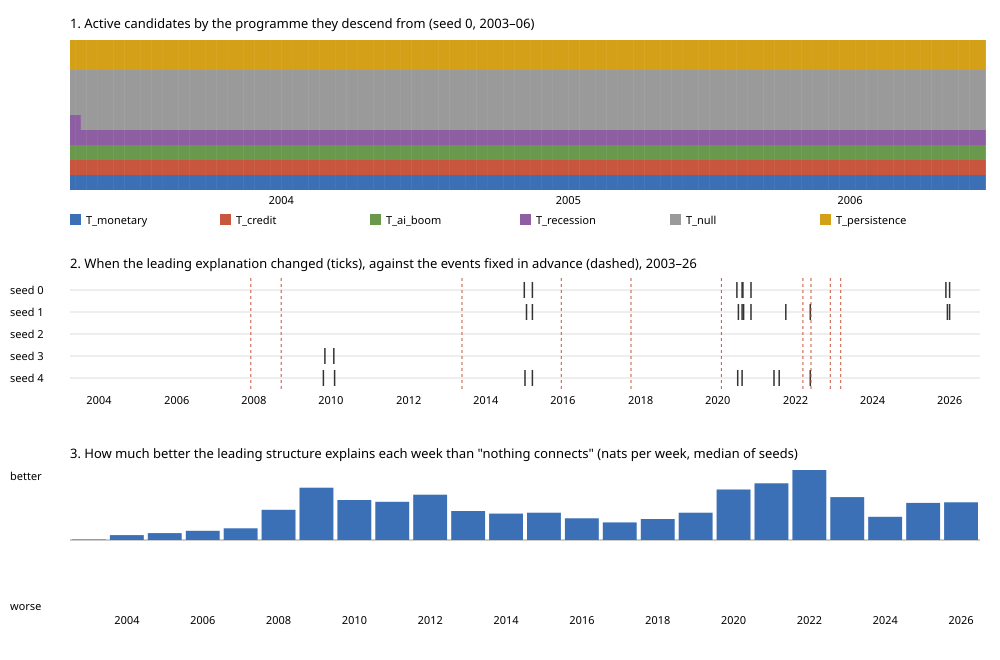

# Probabilistic Ontology Engine

A working argument about how beliefs should be held, revised and given up,
written as software. The engine starts with no hypotheses, only a domain's
concepts. It forms rival explanations of the domain from the evidence (how
inflation, credit, the dollar and the rest of the macro economy bear on
each other, for instance), weighs each against the evidence as it arrives
week by week, and changes its mind when the evidence says to. It is not a
forecaster, and is not tuned to be one; it is meant to be legible as
epistemology, and its forecasts are watched only as a check on its honesty.

It runs live over eleven domains fed by public data (FRED, EIA, SEC EDGAR,
GDELT, CoinGecko, SF Open Data and others), behind the
[Epistemic State Monitor](https://epistemic-monitor-production.up.railway.app)
dashboard ([source](https://github.com/technoir7/epistemic-monitor)).



**What's here.** About 19,000 lines of Python (FastAPI, SQLite, pgmpy) and
14,000 of tests: 644 tests (18 of them against the live APIs), including 38 golden snapshots that pin the API,
domains and engine behaviour, with real network calls blocked. The layering
below is enforced by import-linter in CI. Eleven domains learn from public
data on a schedule, deployed on Railway from `main`. Every finding below
comes from a replay planned in writing before it ran, and reruns offline
from data committed here.

## Try it

No API keys needed:

```bash
uv sync
uv run pytest                     # ~40 s, no network
uv run python -m evals.replay --seed 0 --as-published --out /tmp/poe/seed0.jsonl.gz
uv run python -m evals.programmes /tmp/poe
```

The replay feeds 23 years of weekly FRED data (2003–2026, as first
published) through a fresh engine; the last command prints how long each
rival programme survived and led. The findings below come from replays 1–10,
run by an earlier engine that began from hand-written worldviews; to
reproduce replay 10 exactly, check out `d2a8f6cb`, the last commit before
the engine began forming its own (REFACTOR_SPEC D24). The current engine
has not yet been replayed.

## How it holds beliefs

It begins with a domain's concepts, the form of time (each signal's value
last period may bear on this one) and the form of a connection, and with no
hypothesis about how the concepts connect. Each week it forms hypotheses
from the evidence it remembers: for each research programme, the connection
that would best have explained that evidence, offered only when it explains
more than chance could. A new hypothesis is judged only on evidence that
arrives after it is formed. Blind variants revise what it has formed but
never make a hypothesis from nothing.

Belief lives at three levels, each revised by Bayesian updating
([SPEC.md](SPEC.md) §3). The philosophy behind each rule, and where it falls
short, is set out in [EPISTEMOLOGY.md](EPISTEMOLOGY.md).

- **How strong is a relationship?** Each explanation's conditional
  probability tables, learned from the evidence.
- **Does a relationship exist at all?** Every link carries a probability
  of existing, raised or lowered by how much it helps explain the evidence.
- **Which whole explanation do I hold?** A population of rival
  explanations, scored on recent evidence; the best leads, the worst are
  dropped, and variants of the survivors are tried. A change of leader is
  recorded as a paradigm shift, dated by the evidence that caused it, and
  marked as a change of worldview when the new leader comes from another
  research programme or as a revision when it is a variant of the same one.

Four rules, each added after a replay showed the engine needed it
([what each replay found](evals/README.md)):

- **Rivals live until refuted, and the leader is tested.** Every
  explanation belongs to a research programme (the connection between two
  concepts it grew from). A programme's best is kept until the evidence for
  the leader over it is decisive, a Bayes factor above 100 on fit and on
  fit less complexity both, and programmes take turns to propose variants,
  so a rival gets to revise itself before it is judged (Lakatos). When
  nothing else challenges the leader, its defining connection is put on
  trial: the same explanation without it, started level, which takes the
  lead if the connection does no work (Popper; D27).
- **Doubt in a crisis.** When the leading explanation is far more surprised
  by a week than it usually is, everything learned so far counts for half,
  so a world that has broken (COVID) loosens old certainties without making
  calm years fickle.
- **Beliefs about change.** Each signal's value last week is available as a
  cause. That signals persist is not assumed: like any connection, the
  engine must find it in the evidence.
- **Degree is not doubt.** A measured signal is a precise number, so it is
  read as how far it lies from the line that names it: low, middle or high,
  observed exactly (D25). Testimony, what a text asserts, needs reading
  rather than measuring; it belongs to the abductive engine, not here.
- **Know your own confidence.** Each week the engine records whether its
  70% beliefs come true 70% of the time, level by level, judged against
  what the evidence said, and whether its whole population, weighted by
  belief, explains the week better than its favourite.

## What 23 years of evidence did to it

Replayed week by week through 2003–2026 of real FRED data (macro domain,
five seeds, each replay planned in writing before it ran). Replays 1–10
ran the earlier engine, which began from six hand-written worldviews;
replays 11 and 12 begin from nothing (D24), and 12 reads signals as levels
(D25). Fit is measured
in nats, the log of how surprised the engine was by a week's evidence: one
nat less surprise means it gave what happened about 2.7 times the
probability. A Bayes factor above 100 is the conventional threshold for
"decisive".

- **Its rivals were first refuted unfairly.** Through replay 9 every rival
  worldview (monetary, credit-first, AI boom, recession) died by 2005–08,
  most within weeks, none ever revised. Replay 10 found why: the complexity
  penalty was charged twice, a week with no "last week" was scored as a
  free pass, and the rivals were judged on persistence, which none of them
  denies. With refutation by evidence alone, missing values averaged over,
  and persistence a shared assumption, they live until the evidence
  refutes them: monetary and recession to 2010, credit to 2016, AI boom
  and the sparse baseline to 2014–2026, most revising themselves first.
- **No causal story beats persistence.** Given that every signal follows
  its own last week, none of the four worldviews explained the weeks better
  than persistence alone, in any seed, in 23 years. Persistence explains
  each week 0.56 nats better than "nothing connects" and forecasts it from
  last week alone at −3.4 nats against −4.8 for base rates.
- **Doubt fixed COVID.** Without it, the relationships learned over
  seventeen years outlasted the world that produced them, and through
  2020–21 the engine did worse than believing nothing connects; with it,
  every seed did better.
- **It believes as firmly as its evidence, no more.** Judged against each
  signal rounded to true or false, it looked timid: when it said 15%, the
  signal came true 3% of the time. But the evidence itself is soft (on weeks
  that round to true, it puts the signal at 0.75 on average), and judged
  against what the evidence said, it was calibrated to within 1 to 1.4
  points (replay 9). The timidity was in the measure. Leading with
  persistence (replay 10) it is within 4.7 points, slightly unsure in the
  middle: it says 56% where the evidence says 65%.
- **Its paradigm shifts do not follow the headlines.** No change of leading
  programme followed 2008, COVID or the 2022 hikes within six months.
- **The evidence did not rest on hindsight; the hypotheses did.** Replayed
  again with each figure as it was first published (ALFRED vintages,
  before revisions), the beliefs barely moved: inflation read differently
  in 37 of 1,229 weeks, and the same programme led. But the starting
  worldviews were written in 2026 by someone who knew how 2003–2026 went,
  which is why the engine now forms its own (D24).
- **Finer evidence bought fewer beliefs.** Reading each signal in five
  ordered levels instead of yes/no made the engine better calibrated, but a
  five-level relationship costs ten times the parameters, and Occam's razor
  (BIC) left the leader 2–3 links where it had held 8–13. The engine went
  back to yes/no; ordinal tables, which price a relationship by its order,
  are the next thing to try.
- **Read as degrees, the evidence carried more.** Replay 12 read each
  signal as low, middle or high, observed exactly, instead of as a
  probability of "true" (D25). Starting from nothing, the engine found every
  signal's persistence in every seed, mostly within three years (replay 11
  had never found two of them), and every seed seemed to hold one link
  between signals for twenty years: last week's unemployment trend bears on
  NASDAQ momentum (but see replay 14). It settled in 2003 and had no rival
  programme after 2008.
- **It can now change its worldview, when the evidence calls for it.** In
  replay 12 no rival could be founded, because rivals came only from the
  empty start. Now any connection the recent evidence supports and the
  leader lacks founds a rival that denies the leader's hard core, judged
  from level with it (D26). In replay 13 rivals rose and the lead changed
  hands through 2004–06; after 2009 the evidence of any two years showed
  nothing the leader missed, so it kept its worldview. Seeds settled on
  different worldviews (inflation on credit stress, the labour trend on
  tech stocks, tech stocks on the dollar), which the evidence did not
  choose between.
- **Put on trial, those worldviews fell.** When nothing challenges the
  leader, the engine now tests its defining link: the same explanation
  without it, started level (D27, Popper). In replay 14 the version
  without the link won in four seeds by 2006; in the fifth the link had
  already been judged not to exist. From 2009 every seed held each
  signal's persistence and nothing else, and forecast as well as before.
  An engine that forms its own conjectures and tries to refute them
  reaches replays 1–10's verdict: at weekly levels, macro's evidence
  supports that signals persist, and no more.
- **The replays found seven bugs, now fixed**: an inverted dollar signal, a
  CPI lookback that dropped inflation in about half of all weeks, an engine
  seed that never reached the code it was meant to seed, the double
  complexity charge and the free first week above, and a replay measure that
  scored the leader without last week's values, which overstated replays
  6–9's fit gap, and a recorder that counted links the engine had switched
  off as held, which overstated replays 11–13's links between signals.



## Active Domains

Eleven domains are live and registered in the API:

| Key | Module ID | Cadence | Data Sources |
|-----|-----------|---------|-------------|
| `mr` | `macro-regime-v1` | Weekly | FRED |
| `ng` | `natural-gas-v1` | Daily | NOAA + EIA |
| `ai` | `ai-regime-v1` | Weekly | SEC EDGAR + yfinance + FRED |
| `sd` | `sovereign-debt-v1` | Weekly | FRED |
| `cc` | `credit-cycle-v1` | Weekly | FRED |
| `er` | `energy-regime-v1` | Weekly | yfinance + FRED |
| `lm` | `labor-market-v1` | Weekly | FRED |
| `cr` | `crypto-regime-v1` | Weekly | CoinGecko + yfinance + FRED |
| `gp` | `geopolitics-v1` | Weekly | GDELT + FRED |
| `sf` | `sf-urban-v1` | Weekly | SF Open Data + FRED |
| `art` | `art_prestige_regime_v1` | Monthly | Guardian and NYT art-coverage tags, Art Basel & UBS report figures, Chicago and Cleveland museum acquisitions |

Every domain's signals are measured and read as low, middle or high, each with its value last period: eight in most domains, thirteen in art. No domain gives any hypothesis about how its variables connect. Every domain's variables and sources: [docs/domains.md](docs/domains.md).

## Architecture

The engine has three belief levels:

```
Level 3 - Structure:  population of candidate DAGs; dominant hypothesis and paradigm shifts
Level 2 - Edges:      edge existence probabilities updated from evidence
Level 1 - Parameters: CPT counts learned from exact levels, missing values, and soft testimony
```

Core services:
- `LearningService`: CPT updates, soft evidence (`SOFT_OBSERVED`), likelihood scoring.
- `EdgeExistenceService`: BIC-style edge existence updates and pruning.
- `PopulationManager`: candidate scoring, pruning, mutation, paradigm-shift tracking.
- `InferenceService`: pgmpy-backed Bayesian inference.

Variable identity is deterministic via `stable_variable_id(domain_module_id, variable_name)`, preserving evidence continuity across restarts.

Code layout (layers import downward only; enforced by `uv run lint-imports`):

```
api/        HTTP routers, response models, view logic
runtime/    domain registry, settings, ingest/backfill/scheduler
engine.py   the facade over services + stores
services/   learning, edge existence, population, inference
stores/     SQLite repositories, migrations/*.sql, one transaction per learning cycle
model/      CPTs, the candidate score, cadence, domain contract, errors
domains/    one package per domain + sources/ (shared FRED/yfinance clients, helpers)
```

Adding a domain: give its package a `DomainModule` (`domain.py`) and a
`source.open_source(env)`, then add one `DomainRegistration` in
`src/engine/runtime/registry.py`. Nothing else names domains.

## API

All routes accept a `?domain=` query parameter using the domain key (e.g., `mr`, `sf`, `art`):

```
GET  /v1/population/status
GET  /v1/population/candidates
POST /v1/inference/query
GET  /v1/population/lineage/{candidate_id}
GET  /v1/population/shifts
GET  /v1/evidence/recent
POST /v1/ingest/trigger                     # fetch and learn the latest week now; no auth (see below)
POST /v1/ingest/backfill?days=N             # needs Authorization: Bearer $POE_ADMIN_TOKEN
POST /v1/ingest/rebuild?domain=cc&days=730  # forget a domain and relearn it from its sources, in the background; admin token
GET  /v1/ingest/rebuild?domain=cc           # progress, records learned, and any weeks it could not fetch; admin token
GET  /v1/export/narrative-snapshot
GET  /v1/report/{domain}                     # read cached report (no LLM call)
POST /v1/report/{domain}/refresh             # regenerate if snapshot changed (Fireworks); no auth (see below)
GET  /v1/debug/entropy
GET  /v1/debug/evidence-geometry
GET  /v1/debug/learning
GET  /v1/debug/structure
```

`trigger` and `report/refresh` take no token, because the public dashboard
calls them (FETCH NOW, report refresh). That is fine for a demo but not for
a real deployment: anyone can make the server call the upstream APIs on its
keys, and a refresh calls a paid model whenever the snapshot has changed.
A week already stored is not learned twice, so repeated triggers cost API
calls, not correctness. A real deployment would put both behind the admin
token or a rate limit.

## Narrative Export Workflow

```
1. Open the dashboard, select any domain tab.
2. Click [ EXPORT SNAPSHOT ].
3. Browser downloads prompt + JSON state as a .txt file.
4. Paste into an LLM session for offline epistemic interpretation.
```

Exported regime state uses BN inference posteriors, not soft priors.

## Running

```bash
cd probabilistic_ontology_engine
uv sync            # creates .venv from uv.lock
uv run uvicorn src.engine.api.app:app --host 0.0.0.0 --port 8000 --reload
```

Environment (`.env`):

```bash
FRED_API_KEY=...                    # required for MR, AI, SD, CC, ER, LM, CR, GP, SF
EIA_API_KEY=...                     # required for NG
GUARDIAN_API_KEY=...                # required for art (Guardian Open Platform, free developer key)
NYT_API_KEY=...                     # required for art (NYT Archive API, free developer key)
FIREWORKS_API_KEY=...               # required for POST /v1/report/{domain}/refresh
EVIDENCE_SCHEDULER_ENABLED=true
POE_DATA_DIR=/data                  # Railway: persistent volume mount; default "." loses reports on redeploy
POE_ADMIN_TOKEN=...                 # enables backfill, replace and rebuild; unset = those routes return 503
POE_CORS_ORIGINS=https://your-dashboard.example,http://localhost:3000   # default "*"; read before .env loads, so set it in the real environment
```

No key required for SF Open Data, CoinGecko public endpoints, GDELT, or the Chicago and Cleveland museum APIs. SEC EDGAR requires only a valid `User-Agent` header.

## Tests

```bash
# Standard suite (live tests excluded automatically; real HTTP is blocked):
uv run pytest

# Live tests only (hit real external APIs):
uv run pytest -m live

# Regenerate golden snapshots after an intentional behaviour change,
# then review the snapshot diff before committing:
POE_UPDATE_GOLDEN=1 uv run pytest tests/golden
```

`tests/golden/` pins engine, API, domain and calendar behaviour as committed
JSON snapshots; see `REFACTOR_SPEC.md` §7 Phase 0.

Open problems, and what the replays suggest about each: [NEXT.md](NEXT.md). Design decisions
and their reasons: `REFACTOR_SPEC.md` §8.
