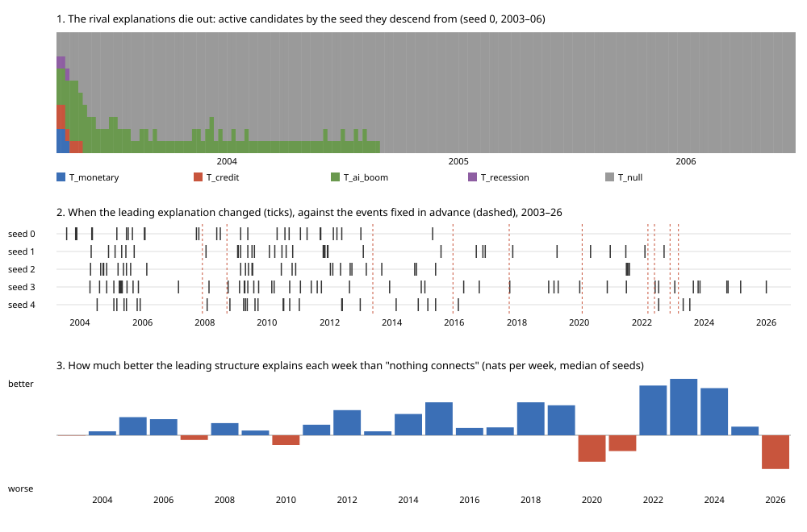
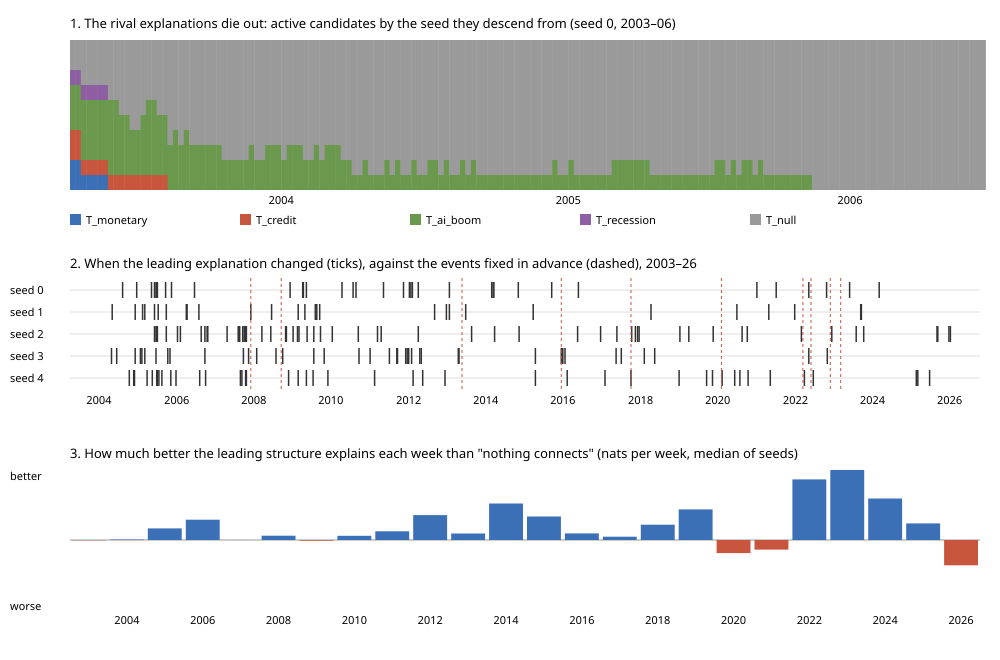
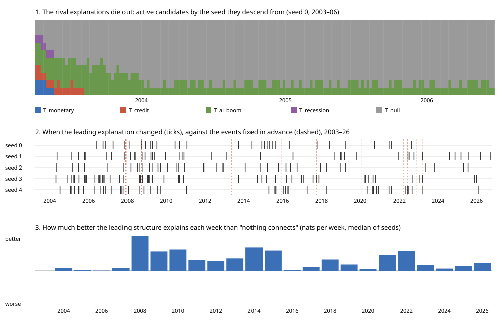
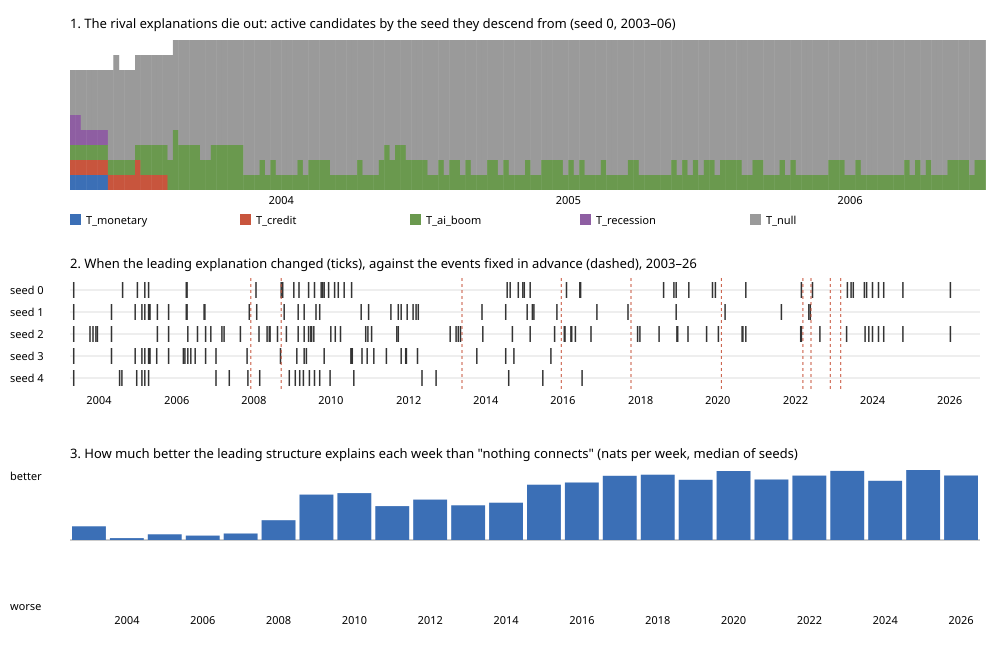
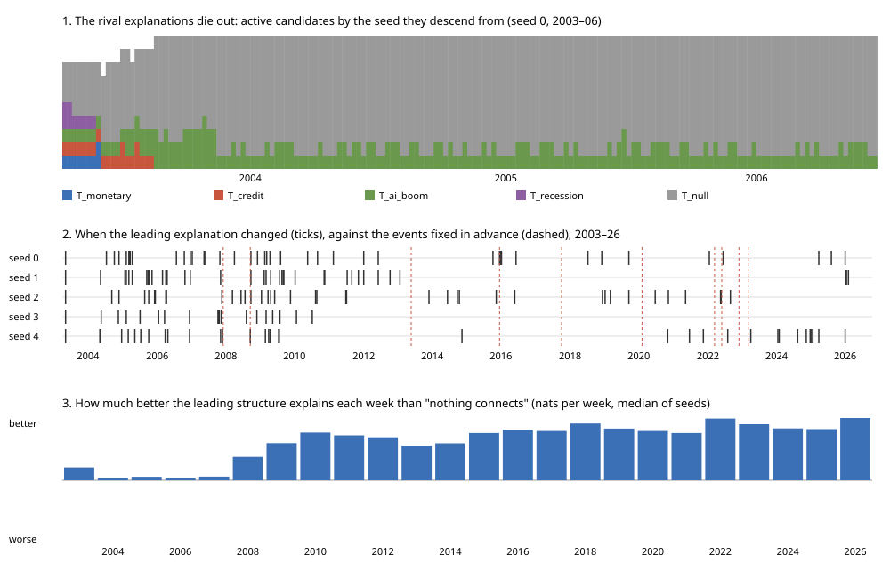
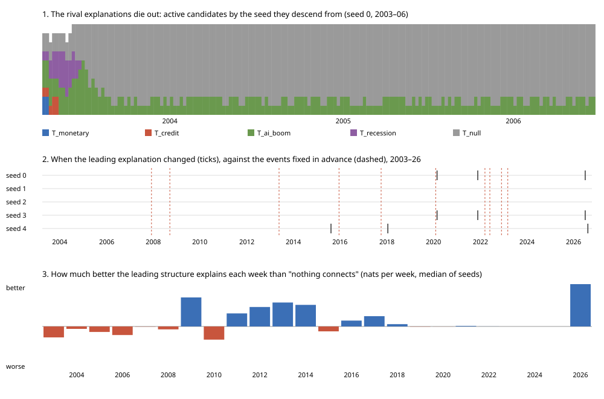

# Does the engine notice when the economy changes? A replay of 2003–2026

*The plan was written before the measured replay ran; results are at the end.*

The engine is a demonstration of epistemology, not a forecaster: of how
beliefs should be held, revised and given up. So this measures its belief
revision, not its predictions. A rational believer changes its mind when the
world changes, keeps it otherwise, and holds a structure only if it explains
the evidence better than believing nothing connects. Nothing in the engine
is tuned for accuracy here, at that cost or any other.

The engine keeps several competing explanations of how eight macro signals
relate (inflation, the yield curve, Fed liquidity, credit spreads,
volatility, the dollar, the labour market, tech momentum), scores each on
the evidence, and records a paradigm shift when the leading explanation
changes. This asks whether those shifts mean anything: replayed week by week
through twenty years of real data, does the leading explanation change when
the economy did, and does the structure it learns explain each week better
than assuming the signals are unrelated?

## The data

Weekly evidence for the macro domain (`macro-regime-v1`), built by its own
pipeline (`compute_snapshot`) from FRED's full history of each series,
fetched once as public CSV files and kept in `evals/data/fred/`. One record
per week, every Friday from 2003-04-04 (WALCL begins in December 2002 and
its signal needs 14 weeks) to the latest. Each week sees only what had been
published by then (CPI about 45 days after its month, unemployment about
36), within the lookback the live client asks FRED for.

One substitution: FRED now serves the ICE BofA high-yield spread
(`BAMLH0A0HYM2`) only from October 2023, so `CreditSpreadStress` would be
missing for nineteen of the twenty years. The replay uses Moody's Baa
corporate yield minus the 10-year Treasury (`BAA10Y`, from 1986) under the
same rule (above its rolling 52-week mean by a z-score of 1 or more). The
two are reported side by side over the three years both exist.

The data are today's revised series, not what was known each week (CPI and
unemployment are revised after release); the replay can know slightly more
than the engine would have live.

## The replay

A fresh engine, as the app runs it (same scoring, pruning, mutation and
half-life), learns the records oldest first, one learning cycle per week.
After each week it records the leading candidate, which seed explanation it
descends from (its family: monetary, credit, AI boom, recession, null), every
candidate's score, and the structure entropy. Mutation is random, so the
replay runs with 5 seeds (0–4) and every result is reported for each seed
and as the median.

## The events

Fixed here, before any replay, with the date each began:

| Event | Began | Source |
|---|---|---|
| The 2008 recession | 2007-12 (NBER peak) | NBER |
| Lehman Brothers fails | 2008-09-15 | |
| The taper tantrum | 2013-05-22 (Bernanke's testimony) | Federal Reserve |
| The first hike after zero rates | 2015-12-16 | Federal Reserve |
| Quantitative tightening begins | 2017-10 | Federal Reserve |
| The COVID crash | 2020-02 (NBER peak); markets 2020-03-09 | NBER |
| The 2022 hiking cycle | 2022-03-16 (first hike) | Federal Reserve |
| Quantitative tightening resumes | 2022-06-01 | Federal Reserve |
| Silicon Valley Bank fails | 2023-03-10 | FDIC |
| ChatGPT is released | 2022-11-30 | OpenAI |

## Questions

1. **Do shifts follow events?** For each event, does the leading
   explanation change family within 26 weeks after it began? Reported per
   event and seed. Against chance: the same number of family changes placed
   at random weeks (10,000 draws), the share of events they would "catch".
2. **How many shifts happen away from any event?** Family changes more than
   26 weeks after every event, per seed. A shift a quarter is noise, however
   well some line up.
3. **Does the learned structure explain each week better than none?** Each
   week, before learning it, the leading candidate's probability of that
   week's eight signals (soft evidence, as learned) against a baseline that
   treats them as independent, learned from the same evidence with the same
   half-life. Reported as average log-likelihood per week, overall and by
   period. If structure does not beat independence, the explanations it ranks
   are telling us little.
4. **Does the leader match the story told at the time?** A stated
   expectation, not a test the engine was built to pass: credit-first or
   recession leading through 2008–09; monetary or recession through 2022–23;
   AI boom in 2023–24. Reported as the weeks each family led in each period.

Shown as one chart: the leading family week by week for each seed, with the
events marked.

## Pilot, and two fixes before the measured run

A pilot replayed 2006–2009 with seed 0, to check the replay runs (208 weeks
in about two seconds) and that its signals match what happened. It is part
of the measured period; the events, window and questions above were fixed
before it and not changed after. It found two faults in how the macro
domain reads FRED, both in the live app, both fixed before the measured run:

- **DollarStrength was inverted.** `DEXUSEU` is dollars per euro, so a
  lower rate is a stronger dollar; the domain read a higher one as stronger
  (the sovereign-debt and crypto domains read it correctly). Through 2007,
  as the dollar fell, it read "dollar strength" every week.
- **The CPI lookback was too short.** CPI for a month is published about 45
  days after it begins; a 430-day lookback then holds 12 published months
  for part of every month, one short of what the inflation signal needs, so
  InflationShock went missing. It is 480 days now. Measured over 2024–2026,
  the old lookback would have lost the signal in about half of all weeks.

Nothing about the engine is changed in response to the replay. A change it
suggests would be measured on a new replay, written up separately.

Not tested: other domains, and whether any of this would help anyone make a
decision.

## A third fix, after the replay ran

The first full replay gave all five seeds exactly the same result. The
engine takes a `random_seed` but never handed it to the PopulationManager,
which always mutated with `random.Random(42)`; so every engine, whatever its
seed, has made the same "random" choices, and SPEC §2.2's reproducibility
from a seed was reproducibility from 42. The seed now reaches it
(`tests/level3/test_engine_seed.py`); the app, which uses 42, is unchanged.
The replay was run again with five seeds that differ. The first run is kept
in `data/replay/as-run/`; its one result was the same as seed 0's in kind
(no family change, structure ahead of independence by 0.21 nats a week).

## Results

1229 weeks, 2003-04-04 to 2026-10-16, five seeds.

1. **Do shifts follow events? No: the leading family never changed.** In
   every seed the leader descended from `T_null` every week of the 23
   years, so no event was followed by a family change, and chance, with
   none to place, catches none either.
2. **Shifts away from events: none**, for the same reason.
3. **Is the learned structure worth believing over "nothing connects"?
   Yes, except when the world broke.** Each week, before learning it, the
   leading structure gave that week's eight signals more probability than
   independent signals did, by 0.17 to 0.29 nats a week across the seeds
   (median 0.24). By period, median of seeds:

   | Period | Gain over independence (nats a week) |
   |---|---:|
   | 2003–07 | 0.12 |
   | 2007–09 | 0.32 |
   | 2010–19 | 0.28 |
   | 2020–21 | **−0.36** (every seed below zero) |
   | 2022–23 | 0.91 |
   | 2024–26 | 0.21 |

   Through COVID every seed would have done better believing nothing
   connected: the relationships it had learned over seventeen years broke,
   and it did not let go of them fast enough. By 2022 it had relearned
   them, and the tightening cycle is where its structure helped most.
4. **Did the leader match the story told at the time? No.** `T_null`'s
   line led throughout 2008–09, 2022–23 and 2023–24 in every seed; the
   credit, recession, monetary and AI-boom explanations were not there to
   lead.

**Why: the rivals die young.** The population starts with ten candidates
across the five seed explanations. Within 14 to 25 months, by mid-2004 to
mid-2005 in every seed, every active candidate descends from `T_null`.
Most likely, the sparsest explanation scores best while evidence is thin
(its BIC penalty is smallest), pruning removes the bottom quartile, and new
candidates are bred only from the survivors, so once a lineage leads early
the others have no way back. This was not tested separately. What the engine calls a paradigm shift after that
(29 to 52 changes of leader per seed, 20 to 27 distinct leading structures)
is one lineage adding and removing an edge at a time: normal science, in
Kuhn's terms, with no rival paradigm left to shift to.

Not planned, so only exploratory: those within-lineage leader changes do not
follow the events more than chance would. The share of events followed by
one within 26 weeks ranged from 2 to 8 of 10 across seeds, against 4.7 to
6.8 at random; the chance of doing as well at random was 0.12 to 0.99. Every
seed did change leader within 26 weeks of Lehman's failure.

**The stand-in credit spread** (Moody's Baa less the 10-year Treasury)
agreed with the ICE high-yield spread's CreditSpreadStress in 71 of the 104
weeks both could be read (68%). Close enough to carry the variable's
meaning, not to stand for it exactly; the high-yield spread reacts faster.

**Also found, in the live app's data.** In a backup of the live macro
database (2026-10-16), 2,674 of its 4,144 evidence records (65%) carry no
information: every signal recorded as 50/50 at confidence 0.5. Most were
written on days other than Fridays, though the domain is weekly. Current
code records a signal it could not compute as MISSING rather than 50/50
(REFACTOR_SPEC D10), so these are probably from older code, but the live
population learned from them, and the dashboard shows what it learned.

## What this suggests, for the epistemology

These are not changes made here; each would be a new replay.

- **Keep rivals alive.** A believer that lets every alternative die cannot
  change its mind, only adjust it. Pruning within each seed lineage rather
  than across the population, or keeping at least one candidate per
  lineage, would keep Lakatos's competing research programmes in play, so
  that a shift between worldviews stays possible.
- **Let a broken structure lose faster.** COVID is where it held its
  beliefs too long. A score half-life that shortens when the leader's
  recent surprise is far above its usual (a crisis widens the window of
  doubt) would let it give up a failing structure sooner, without making it
  fickle in calm years.
- **Clean the live record, and relearn it.** Rebuild the live macro
  population from this replay's evidence, after removing the blank records.

## Replay 2: rivals kept until refuted

*Plan, written before replay 2 ran.*

The change (REFACTOR_SPEC D15): every candidate carries the seed explanation
it descends from, its research programme, and pruning spares each
programme's best candidate until the evidence for the leader over it is
decisive, a Bayes factor above 100 on Jeffreys' scale. A programme can still
be abandoned, but only when refuted, not for ranking low while the evidence
is thin. Nothing else changes: same data, events, window, seeds and
questions as above, written to `data/replay2/`.

One question more:

5. **Do the rivals survive, and do they ever lead?** The number of
   programmes alive each year, and the weeks each one leads. If they
   survive but never lead, the population keeps alternatives in mind
   without ever finding the evidence to adopt one.

A change in the fit gap (question 3) is reported but not expected: the
leader is still the best-scoring candidate, so keeping rivals should not
make it worse, unless it changes which lineage breeds.

### Replay 2 results

1. **Shifts and events: still none caught.** Three seeds changed family
   twice, both times in the same two weeks of July 2005, when the AI-boom
   programme led for one week; no event was followed by a family change.
2. **Shifts away from events:** those two, in three seeds.
3. **Fit gap:** 0.19 to 0.30 nats a week (median 0.24, as before). Through
   COVID, three seeds still did worse than independence; two did not.
4. **The story told at the time:** not matched; `T_null`'s line led
   2008–09, 2022–23 and 2023–24 in every seed.
5. **Rivals survived longer, then were refuted.** All five programmes were
   alive in 2003; two in 2004 and 2005; by 2008, one in every seed. The
   rivals were not lost for ranking low: by 2008 the evidence against each
   passed 100 to 1.

So the null lineage's win holds up under a fairer rule. One unfairness
remains: variants are bred from the best-scoring candidates first, so a
rival programme rarely gets offspring while the leading lineage keeps
exploring. A programme judged without being allowed to revise its
auxiliary hypotheses (in Lakatos's terms) has not had a fair trial.

## Replay 3: a fair trial for rivals

*Plan, written before replay 3 ran.*

The change (REFACTOR_SPEC D16), on top of replay 2's: each round of breeding
starts with a different programme's best candidate, so every surviving
programme gets to revise itself. Same data, events, seeds and questions
1–5, written to `data/replay3/`. If the rivals still fall by 2008, the null
lineage's win is not an artefact of who was allowed to breed.

## Replay 4: doubt in a crisis

*Plan, written before replay 4 ran.*

The change (REFACTOR_SPEC D17), on top of replay 3's: when the leading
structure is more surprised by a week than its usual by two standard
deviations (after a year of evidence), every candidate's learned counts and
score window count for half before it learns that week. Ordinary weeks
change nothing. Same data, events, seeds and questions 1–5, written to
`data/replay4/`, and one more:

6. **When does it doubt, and does doubt help?** The weeks it judged a
   crisis, against the events; and the fit gap through COVID (2020–21),
   where replays 1–3 did worse than independence in most seeds, and in
   calm periods, where doubt could make it worse.

### Replay 4 results

Run twice: first with the independence baseline remembering everything
while the candidates forgot in a crisis, which made structure look twice as
good as it was; then, as the plan intended ("learned from the same
evidence"), with the baseline forgetting on the same weeks. Only the second
is reported.

1–2. **Shifts and events: none caught.** One seed (4) changed family nine
   times between 2005 and 2007, ending with the AI-boom programme leading
   from September 2007 to the end; none of the changes followed an event.
3. **Fit gap:** 0.13 to 0.24 nats a week (median 0.17), lower than replay
   3's 0.27, because the independent baseline also gains from forgetting.
   **Through COVID every seed now beats independence** (0.07 to 0.28),
   where four of five fell below it before.
4. **The story told at the time:** not matched.
5. **Rivals:** one programme alive from 2008 in four seeds; two in seed 4
   until 2020.
6. **Doubt.** 21 to 38 crisis weeks per seed over 23 years, most of them in
   2005–06, while the population was still settling; others in 2009, 2010–11,
   2015–16 and 2018–19. They do not line up with the events either. Doubt
   helps the believer: its own average log-likelihood per week rose from
   −4.96 to −4.62 (median of seeds), from −5.33 to −4.41 through COVID, and
   from −4.66 to −4.45 in 2010–19, so it did not make calm years worse.

## Replay 5: calibration and humility

*Plan, written before replay 5 ran.*

The change (REFACTOR_SPEC D18) observes and learns nothing: before each
week is learned, the engine records how well the whole population, each
structure weighted by its posterior weight, predicted that week, and, for
each signal, the probability the leader and the weighted population gave it
being true given the week's other seven signals. Learning is replay 4's, so
the leaders and crises are the same; written to `data/replay5/`.

7. **Humility: does the weighted population explain the evidence better
   than its leader?** Average log-likelihood per week, population against
   leader.
8. **Calibration: when it says 70%, is it right 70% of the time?** The
   Brier score and the expected calibration error (ten bins) of the
   leader's and the population's leave-one-out probabilities, against a
   believer that always says each signal's base rate so far.

### Replay 5 results

7. **Humility gains nothing yet.** The weighted population predicted each
   week as well as its leader and no better (−4.57 to −4.71 nats a week,
   within 0.006 of the leader in every seed): with posterior weights taken
   over a window of about 150 records, nearly all the weight sits on the
   leader. The population is all but certain of its favourite.
8. **Its confidence is informative but timid.** Over 9,824 judgements per
   seed, its Brier score was 0.16 to 0.17 against 0.216 for a believer
   saying each signal's base rate, so it knows a good deal about each
   signal from the others. But its calibration error (0.07 to 0.10) is a
   little worse than the base rate's (0.06), and in the direction of
   diffidence: when it said 15% the signal was true 3% of the time; when it
   said 84%, 97% (seed 0). It holds its beliefs more weakly than its
   evidence warrants.

## Replay 6: beliefs about change

*Plan, written before replay 6 ran.*

The change (REFACTOR_SPEC D19), on top of replay 5's: each signal has a
companion holding its value last week, which any structure may take as a
parent and none may explain, and a sixth programme, `T_persistence`, holds
that each signal follows its own last week and nothing else. Each week the
leader's forecast is also recorded: the probability it gave this week's
signals from last week's alone, before seeing any of them. Explanation
still decides what is believed; the forecast is watched, not rewarded.
Same data, events, seeds and questions 1–8, written to `data/replay6/`,
and one more:

9. **Is persistence the better worldview, and does believing in change
   forecast better?** Which programmes lead and survive with persistence
   available; the leader's forecast log-likelihood per week, against
   replay 5's leader, which could only forecast from base rates (its
   structure had nothing to go on but this week).

### Replay 6 results

1–4. **Shifts, events and the story: as before.** Every seed's first leader
   was `T_persistence`, for five weeks; then the leader passed to another
   programme and stayed (in four seeds `T_null`'s line; in seed 2, after
   six changes in 2003–07, the AI-boom line). No event was followed by a
   family change.
5. **Rivals:** two programmes alive into 2004–08, one from 2015.
7–8. **Humility and calibration:** much as in replay 5 (Brier 0.16 to
   0.17; the population no better than its leader).
9. **Persistence won by being absorbed.** It led only the first five
   weeks, yet by 2003–05 every surviving programme's leader had taken links
   from last week (3 to 8 of its 6 to 11 links by 2026), mostly a signal
   following its own last week, and `T_persistence` was refuted as a rival
   while its idea lived on in the others: a programme absorbing a rival's
   content, in Lakatos's terms. With them the leader explains each week far
   better than in replay 5 (−2.2 to −3.6 nats a week, from −4.6), and
   forecasts each week from last week's signals alone at −3.8 to −4.1 nats,
   against −4.8 for base rates. The fit gap over independence (question 3)
   rose to 1.2 to 2.6 nats a week, but most of that is persistence, which
   the independent baseline does not have.

## Replay 7: as first published

*Plan, written before replay 7 ran.*

Replays 1–6 used today's revised CPI and unemployment, so each week could
know a little more than it did at the time. Replay 7 is replay 6 with those
two series as they were first published: for each week, the latest
monthly ALFRED vintage taken on or before it (CPI on the 16th, after its
mid-month release; unemployment on the 8th, after its first-Friday
release), so a week may see a release a few days late but never one not yet
made. The market series are not revised. Written to `data/replay7/`; the
engine is replay 6's.

10. **Does honesty about what was known change the beliefs?** Questions
    1–9 as before, and how many weeks the inflation and labour-market
    signals differ from replay 6.

### Replay 7 results

10. **Honesty about what was known changed little.** As first published,
    InflationShock differed from replay 6 in 37 of 1,229 weeks and the
    labour signal (EquityRiskOn) in 28. The beliefs barely moved: `T_null`'s
    line led throughout in two seeds and almost throughout in the others,
    where the AI-boom line led for 11 to 42 weeks; no event was followed by
    a family change. The leader explained each week a little less well in
    four seeds (it knew a little less) and better in one, forecast it from
    last week at −3.6 to −4.1 nats against replay 6's −3.8 to −4.1, and was
    as timid (Brier 0.14 to 0.17). So nothing in replays 1–6 rests on
    hindsight; replay 7 is the honest baseline from here on.

## Replay 8: five levels

*Plan, written before replay 8 ran.*

The change (REFACTOR_SPEC D20), on top of replay 7's: each macro signal is
recorded in five ordered levels, from well below its threshold to far past
it, cut from the same evidence (the three levels past the threshold sum to
the old probability of "true"). Same data as first published, events,
seeds and questions as replay 7, written to `data/replay8/`. Log-likelihoods
over five levels and over two are not on one scale, so the comparison with
replay 7 is made where they agree:

11. **Does believing in degrees make it a better believer?** The Brier
    score and calibration error of its belief that each signal is past its
    threshold, given the others (the same event replay 7 judged), against
    replay 7; which programmes lead; how many links the leader holds; and,
    within each replay, the fit gap over independent signals and the
    forecast from last week against base rates.

### Replay 8 results

11. **Degrees made it more careful and less knowing.** Judged on the same
    event as replay 7 (is each signal past its threshold, given the
    others), its calibration error fell (0.060 to 0.078 against replay 7's
    0.066 to 0.119; it is less timid) but its Brier score rose (0.19
    against 0.14 to 0.17; it knows less from the other signals). Its
    leader held 2 or 3 links where replay 7's held 8 to 13, and its gain
    over independent signals fell to 0.04 to 0.26 nats a week. The cause
    is the price of a relationship: explaining a five-level signal by a
    five-level cause takes 20 numbers where a boolean pair took 2, and the
    BIC penalty, the engine's Occam's razor, finds that 23 years of weekly
    evidence support few relationships at that resolution. Persistence was
    worth more: from last week alone it forecast each week 1.6 nats better
    than base rates (replay 7: 0.8, on its own scale). `T_null`'s line led
    every week in every seed; no event was followed by a change.

    A finer instrument asks for more evidence per belief. Levels would pay
    for relationships with more data, or with tables that use the levels'
    order (an ordinal model needs a few numbers per cause, not 20). The
    engine went back to yes/no signals; the levels are in commit 1290d1c6,
    to try again with ordinal tables.
